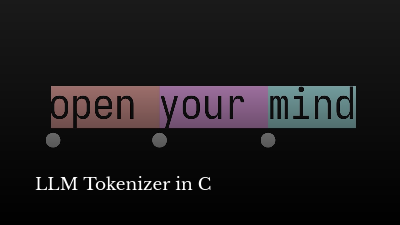

# Source

The original author of this software is [Tsoding](https://github.com/tsoding).

https://github.com/tsoding/bpe

Highly recommand watching this video for your personal culture:

Files modified:
- nob.c was removed
- bpe_gen.c:92 assert was removed (causes for tokens to simply not load on my testing, see https://github.com/tsoding/bpe/issues/3)
- data/full_source.txt which contains all the source code of the program generated with `cat ../**/*{.c,.h} > full_source.txt`

# Get the source code

Get the `bpe.tar.gz` and untar it with:

`tar -xvf bpe.tar.gz`

This will create a bpe folder containing all the source material.

# Goal

You must create a Makefile that does the following:
- Sets the `CFLAGS` to `-Wall -Wextra -O3`
- Sets the include folder flag to point to `thirdparty/` using the right variable ([hint](https://www.gnu.org/software/make/manual/html_node/Implicit-Variables.html#index-CPPFLAGS))
- Builds a `txt2bpe` binary:
    - Sources:
      - `src/bpe.c`
      - `src/txt2bpe.c`
- Builds a `bpe_inspect` binary:
    - Sources:
      - `src/bpe.c`
      - `src/bpe_inspect.c`
- Builds a `bpe_gen` binary:
    - Sources:
      - `src/bpe.c`
      - `src/bpe_gen.c`
- `generate-bpe`: checks that `txt2bpe` is built and then executes `./txt2bpe -max-iterations 10000 -dump-freq 1000 -input-file data/full_source.txt -output-dir bpe_genned`
- `inspect-bpe`: checks that `bpe_inspect` is built and then executes `./bpe_inspect bpe_genned/9000.bpe`
- `random-text`: checks that `bpe_gen` is built and then **silently** executes `./bpe_gen -bpe bpe_genned/9000.bpe -limit 1000`
- `all`, `clean`, `fclean`, `re` rules (You know what these do :-))

> When "re-running" a rule, make sure it doesn't recompile the binary. The binary must be recompiled only when the source file is changed.

Everything above is only the essentials.
If you wish to go further, you can add the following stuff:
- If no `CC` is specified, build using `gcc`
- If the environment variable `ENV` is set to `dev`, add `-ggdb` to the `CFLAGS`
- Sets the `.PHONY` variable to all rules that don't generate a binary
- Sets an overriden implicit rule to compile from `.c` to `.o` and then echo `file.c built!`

### Answer

In this repo, you have `correct.Makefile.gpg`.

Ask me for the password and then do:
`gpg -d correct.Makefile.gpg`

<!--
Great that you found this. It's not the password but a way to it. Secret code if you would. Thank you for not trying to crack it :)

0c2b8b01e290b7ca0b740d52d031ef1e
-->
